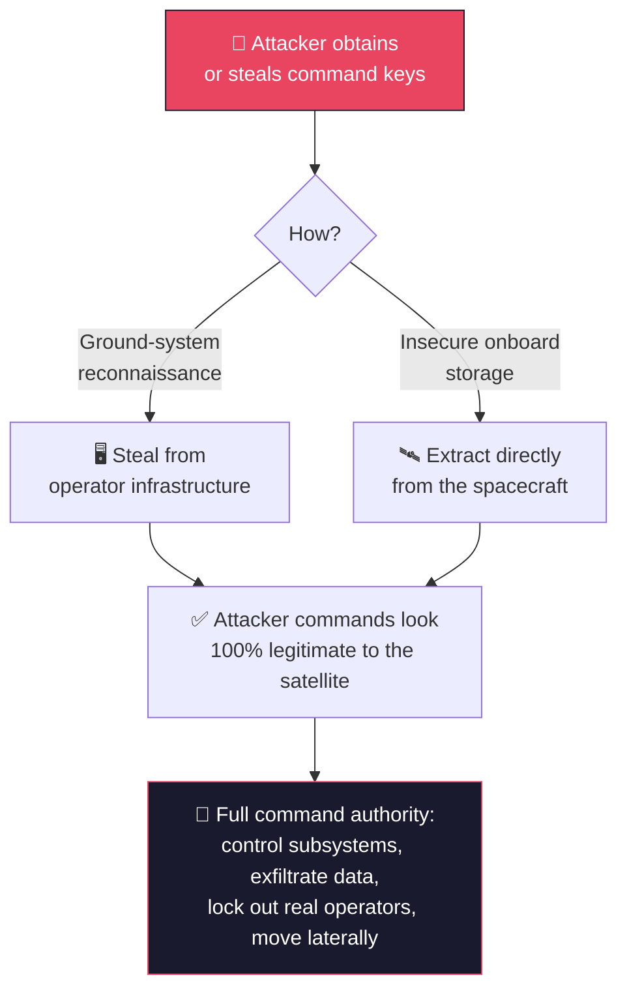

# Command & Control (C2) Hijacking

**Goal:** spoofing aimed specifically at a satellite's command interface — not just feeding a receiver bad data ([`spoofing-injection.md`](spoofing-injection.md)), but convincing the satellite itself to accept and execute commands from someone who isn't the legitimate operator. This is the chain's first real "takeover" milestone: the point where an attacker stops fooling a system and starts *controlling* one.

---

## How it actually works

The core of C2 hijacking is almost always about **keys**, not cleverness. A satellite's command link is normally protected by cryptographic authentication — the spacecraft only executes commands it can verify came from the real ground segment. Break that verification, and you don't need to "hack" anything else; the satellite will do exactly what it's told, because as far as it can tell, it's being told by its own operators.

Per MITRE/Aerospace Corp's SPARTA threat framework, once an attacker has valid keys (or has replaced the satellite's keys with their own), they gain:

- **Full command access** — can command the spacecraft and its subsystems directly, without going through the legitimate ground segment at all.
- **Persistence** — the stolen credentials themselves function as a foothold; no need for an ongoing backdoor.
- **Concealment** — because the credentials are real, malicious commands look exactly like legitimate operator traffic. There's often nothing to flag.
- **Lateral movement** — the same access can potentially reach other subsystems, other buses, or even other satellites in a constellation.
- **Data theft** — mission data can be exfiltrated as it's gathered, processed, and transmitted.

In the worst case, an attacker can go further than just *using* stolen keys: they can exploit weaknesses in over-the-air rekeying to **replace** the satellite's cryptographic keys entirely — which locks the legitimate operators out completely. From their perspective, they haven't been hacked; they've simply lost commanding access, with no obvious culprit.

## This has already been done — on a real satellite, in orbit

In April 2023, at the CYSAT conference, Thales ran an ESA-sanctioned ethical hacking exercise against **OPS-SAT**, a real ESA nanosatellite in orbit, to find out exactly how far a real cyberattack could go. ESA itself set up the test bench and gave Thales's team technical access to study.

**What they did:**
1. Used legitimate, valid accounts to deploy a third-party application that secretly hid a malicious payload
2. Exploited a deserialization vulnerability in the nanosat's management framework, plus weaknesses in its operating system
3. Used elevated access to take over the satellite's entire application environment — not just one subsystem

**What that got them, on a real satellite in space:**
- Control of the system managing the payload's GPS, attitude control, and onboard camera
- The ability to alter images the camera had already captured
- The ability to mask specific geographic areas out of the satellite's imagery
- The ability to conceal their own activity from ESA's own monitoring

This wasn't a simulation or a tabletop exercise — it was a live demonstration, on a satellite genuinely in orbit, of exactly what a successful C2 compromise can actually do.

## Why this matters for the end-to-end chain

This is the milestone this repo's whole specialty builds toward: real command authority over a satellite, not just disruption or deception. From here, the chain splits into two directions covered next — going *deeper* into what's actually running behind that command interface ([`satellite-bus-attacks.md`](satellite-bus-attacks.md)), and making sure a takeover like this stays hidden once achieved ([`replay-telemetry-tampering.md`](replay-telemetry-tampering.md)).

---

**Next:** [`satellite-bus-attacks.md`](satellite-bus-attacks.md) — once you have command access, what's actually sitting behind it: the onboard bus, firmware, and subsystems.

