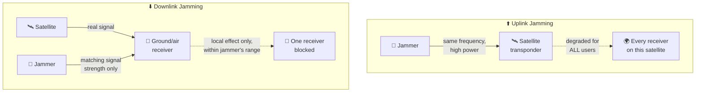

# Jamming / Denial of Service

**Goal:** deny service by overwhelming the legitimate signal — no need to understand what the signal *means*, just where it is on the spectrum. This is the simplest active attack in this folder: a step up from the passive listening of [`signal-interception.md`](signal-interception.md), but still far simpler than spoofing or hijacking, since you're not trying to fool anything — just drown it out.

---

## How it actually works

Jamming is an electronic attack: transmit interfering radio signals at the same frequency the target satellite link is already using, within view of the relevant antenna. It's non-destructive — once the jamming stops, communications recover on their own, which is part of why it's such an accessible, low-commitment attack. A jammer doesn't need to be anywhere special either: it can operate from the ground, the sea surface, or the air.

### Uplink jamming vs. downlink jamming

- **Uplink jamming** targets the signal going *up* from a ground station or terminal to the satellite. The jammer needs considerable transmitter power — it has to overpower the real signal from much further away — but if it succeeds, it degrades the satellite's output for *every single user* on that transponder, not just one target.
- **Downlink jamming** targets the signal coming *down* from the satellite to a receiver. The jammer only needs to be as strong as the signal already arriving on the ground at that spot — far less power required — but its effect stays local, limited to whoever's within the jammer's own field of view.

This is the same asymmetry noted in [`attack-surface/link-segment.md`](../attack-surface/link-segment.md): downlink jamming is generally the easier, more reliable attack to pull off, even though it reaches fewer people.

## This is happening right now, at a geopolitical scale

GPS jamming isn't just a ground-based, localized nuisance anymore — it may be moving into orbit itself.

In 2026, researchers at UT Austin and Stanford analyzed GPS interference data across Europe, Greenland, and Canada going back to 2019. They found a distinct pattern: sharp bursts of interference lasting under 10 seconds, hitting the same frequencies, concentrated during European business hours — mostly Tuesday through Thursday. For one event in February 2026, the team used timing and location data to trace the source to a specific satellite: **Kosmos 2546**, a Russian satellite linked to Russia's Edinaya Kosmicheskaya Sistema (EKS) early-warning network — traced to roughly 5 meters of accuracy.

One researcher, Todd Humphreys, called it "a massive escalation in the electronic warfare background conflict." The study hasn't been peer-reviewed yet, and Russia's involvement hasn't been officially confirmed — some experts are genuinely skeptical Russia would risk its only early-warning satellite network for this. But the pattern itself is documented and real: if satellite-based GPS jamming at this scale is happening, the implications are mostly military — degraded navigation and coordination for anyone relying on GPS across an entire continent, not just one target.

## Why this matters for the end-to-end chain

Jamming doesn't get you control of anything — it's denial, not takeover. But it's a useful tool on its own (disrupting a target without needing to understand or fake its traffic), and it's a stepping stone technically: the same frequency-targeting skill jamming requires is also the foundation for [`spoofing-injection.md`](spoofing-injection.md), where instead of drowning the signal in noise, you replace it with something convincing instead.

---

**Next:** [`spoofing-injection.md`](spoofing-injection.md) — now content matters: impersonating a legitimate signal instead of just overpowering it.

