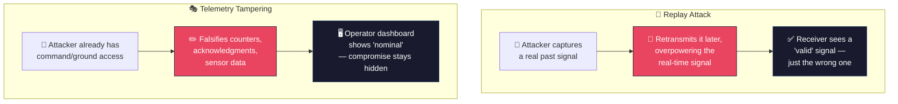

# Replay & Telemetry Tampering

**Goal:** the final piece of the chain — once an attacker has command authority ([`c2-hijacking.md`](c2-hijacking.md)) and bus-level control ([`satellite-bus-attacks.md`](satellite-bus-attacks.md)), the last problem to solve is staying *invisible*. This file covers the two techniques that make that possible: replaying real signals to overpower legitimate ones, and falsifying telemetry so operators keep seeing a healthy, nominal spacecraft while something else entirely is happening.

---

## How it actually works

These are two related but distinct techniques:

- **Replay attacks** capture a real, previously-sent signal and retransmit it later — strong enough to overpower the legitimate transmission happening at the same time. The receiving end doesn't see "noise" the way jamming produces; it sees what looks like a perfectly valid signal, just not the one that was actually meant to be there right now.
- **Telemetry tampering** works from the other end: instead of attacking the radio signal itself, it falsifies the data *inside* the ground system after a legitimate command/command-authority foothold already exists — altering command counters, acknowledgments, housekeeping data, or sensor readings so the dashboards operators are watching show "all normal" even while the spacecraft is being actively manipulated.

## Replay attacks: demonstrated on real spacecraft communication systems

A 2025 academic study tested exactly this against the communication systems of NASA's **Orion** spacecraft — the vehicle built for crewed deep-space missions. Researchers used software-defined radios paired with a real-time channel emulator to recreate realistic attack conditions and measured how badly a replayed signal could degrade the legitimate uplink/downlink.

The result: a replayed signal can measurably overpower real transmissions, with signal-to-noise degradation reaching **-7.8 dB during re-entry** and **-6.5 dB during launch** — specifically chosen because these are the most exposed, time-critical, and operationally stressed phases of an entire mission, when a controller has the least slack to notice something is wrong and the least time to react if they do. The same researchers also proposed a defensive fix (a phase-coherency-dependent receiver design), underscoring that this isn't a theoretical weakness — it's one specific enough that a specific counter-design was needed to address it.

## Telemetry tampering: the formal deception framework

MITRE/Aerospace Corp's SPARTA threat framework — already used in [`c2-hijacking.md`](c2-hijacking.md) for the key-theft mechanism — has a dedicated technique for this exact scenario: **DE-0002.01, "Disrupt or Deceive Downlink: Inhibit Ground System Functionality."** It describes an adversary who already has ground-system access using two different approaches:

- **Disruption** — denial-based: disabling telemetry software, corrupting the data-processing pipeline, crashing the display interface the operators actually look at.
- **Deception** — the more dangerous option: quietly falsifying the data itself (command counters, acknowledgments, housekeeping data, sensor outputs) so that everything *looks* nominal even while it isn't.

SPARTA is blunt about why deception is the technique that matters most here: suppressed alerts and misleading telemetry block both automated systems and human operators from responding — not because the attack is loud, but specifically because it's quiet. A system under attack that still reports "green across the board" buys an attacker exactly the kind of time that every earlier technique in this folder was built toward getting.

## How this gets defended against

SPARTA's own mitigation list for this technique is a useful closing note for the whole offensive-techniques folder, since it maps almost one-to-one onto the weak points this folder has walked through:

| Mitigation | Addresses |
|---|---|
| Strong cryptography on the command link, with no "crypto-bypass" mode allowed | The key-theft/replacement path in [`c2-hijacking.md`](c2-hijacking.md) |
| On-board message encryption (not just authentication) | The unsegmented, unauthenticated bus in [`satellite-bus-attacks.md`](satellite-bus-attacks.md) |
| Secured ground networks, built to NIST frameworks | The ground-segment and VSAT-network weaknesses in [`attack-surface/ground-segment.md`](../attack-surface/ground-segment.md) and [`vsat-network-attacks.md`](vsat-network-attacks.md) |
| Alternate communication paths, so one compromised link can't take down everything | The single-point-of-failure pattern running through jamming, spoofing, and C2 hijacking alike |

## Why this matters for the end-to-end chain

This is where the chain this folder has been building actually closes. Interception told an attacker what's there. Jamming and spoofing showed how to disrupt or deceive the link itself. C2 hijacking and bus attacks showed how to turn that into real control. This file is the step that makes all of it sustainable: without a way to stay hidden, every technique above is eventually noticed and shut down. With it, a compromise can persist — which is exactly why "detect the deception, not just the intrusion" is the thread running through nearly every mitigation listed above.

---

**That's the full chain.** From understanding why satellite cybersecurity matters at all, through the fundamentals of how satellites actually work, through where the real-world attack surface sits, to the specific offensive techniques that chain across it — this repo's reading order is complete. Back to [`../README.md`](../README.md) for the full map.
