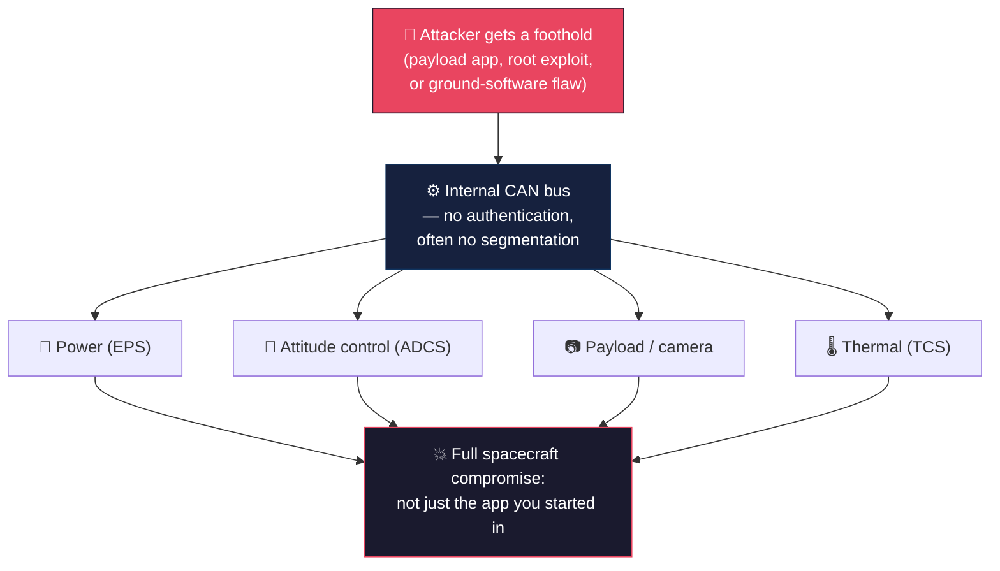

# Satellite Bus Attacks

**Goal:** go past the command interface itself and reach what's actually sitting behind it — the satellite's onboard bus, the internal wiring that lets its subsystems (power, attitude control, payload, thermal) talk to each other. [`c2-hijacking.md`](c2-hijacking.md) got an attacker a legitimate-looking command channel; this file is about what that access can actually reach once it's inside.

---

## How it actually works

A satellite isn't one single computer — it's a handful of separate subsystems (as covered in [`fundamentals/hardware-components.md`](../fundamentals/hardware-components.md)) wired together over an internal bus, most commonly **CAN bus**, the same kind of bus used in cars. CAN bus was designed for reliability on a factory floor or a car dashboard, not for security — it has no built-in authentication, so any device on the bus can send a message that any other device will process, no questions asked, as long as the message looks correctly formatted.

That design choice is fine as long as nothing malicious ever gets onto the bus. The problem is what happens once something does — through a compromised payload, a vulnerable ground-software exploit, or stolen command keys. There's nothing stopping that foothold from sending messages to subsystems it was never supposed to talk to at all.

The two things that make this jump possible, over and over, in real research:

- **No bus segmentation** — every subsystem sits on the same bus with no boundaries between them, so a message meant for the payload can reach the attitude-control system too.
- **Processes running as root** — when onboard software has more privilege than it needs, a single exploited process can act with full authority over everything else on the bus.

## This has already been demonstrated — on the same real satellite as c2-hijacking.md

Going back to Thales' 2023 CYSAT demo against ESA's OPS-SAT (first covered in [`c2-hijacking.md`](c2-hijacking.md)) from the bus angle specifically: the attack didn't start on the bus at all. It started with a simulated software-supply-chain trick — a legitimate-looking third-party app, hiding a deserialization vulnerability, uploaded through valid accounts, which got past ESA's own pre-upload scanning because it wasn't obvious malware.

From there:
1. The deserialization flaw gave code execution inside the payload application.
2. An operating-system weakness let that foothold escalate to **root**.
3. Because OPS-SAT's internal **CAN bus had no segmentation**, and multiple onboard components ran as root, the attacker's messages reached software that was never meant to receive traffic from the payload at all.
4. They planted a backdoor (malicious bytecode inserted into a Java JAR file) for persistence, then used the resulting access to alter already-captured camera imagery and mask specific geographic areas from it.

The Aerospace Corporation's own writeup of the demo is blunt about what this means beyond OPS-SAT: unsegmented internal buses are **"a common vulnerability on many spacecraft,"** not a quirk specific to one nanosatellite test article. Their recommended fixes — bus segmentation, least-privilege process management, onboard intrusion detection — are exactly the controls that were missing here.

## A second route to the same place: compromised ground software

Bus-level control doesn't require getting physically clever on orbit at all — sometimes the weak point is the ordinary software operators use to send commands in the first place. In August 2026, security researchers at Cycode disclosed a chain of flaws in **AIT-GUI**, part of NASA/JPL's open-source AMMOS Instrument Toolkit (AIT) — the framework used to build ground systems that command instruments and spacecraft and process the telemetry coming back.

The flaw chain (rated CVSS 9.4) stacked three separate weaknesses:
- The server ignored its own configuration and **listened on every network interface by default**, not just the intended one.
- It handed out a valid session cookie to **anyone**, with zero credential check — a plain `GET /` was enough to get a cookie that then passed the authentication check on the command endpoint.
- It had no protection against cross-site request forgery, meaning a malicious web page could potentially trigger spacecraft commands through an operator's own browser session without them knowingly doing anything.

Put together: anyone who could reach the exposed port could issue arbitrary instrument and spacecraft commands and run server-side scripts, no valid credentials required. A patch narrowed some of this (binding to localhost by default, adding CSRF checks), but researchers note the core credential-free session issue wasn't fully resolved even in the fixed version.

This is a different entry point than OPS-SAT's — no payload exploit, no on-orbit trickery — but it leads to the same place: a path from the ground side straight toward the command bus, skipping the need to steal keys at all.

## Why this matters for the end-to-end chain

This is the point where "I have a foothold" becomes "I have the whole spacecraft." Whether the foothold came from stolen keys ([`c2-hijacking.md`](c2-hijacking.md)), a compromised payload app, or a flaw in the ground software that talks to the bus, the bus itself is usually the weakest link in the chain — flat, unauthenticated, and running privileged code. From here, the last question is how to use that access *without getting caught*, which is exactly what [`replay-telemetry-tampering.md`](replay-telemetry-tampering.md) and [`vsat-network-attacks.md`](vsat-network-attacks.md) cover next.

---

**Next:** [`vsat-network-attacks.md`](vsat-network-attacks.md) — stepping back out to the ground-network side: exploiting the VSAT terminals and infrastructure that connect to this whole chain.
