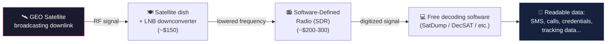

# Signal Interception

**Goal:** passively capture satellite signals to gather intelligence — without transmitting anything yourself, without touching any network, and (as the research below shows) often without needing anything more than a rooftop and consumer electronics.

This is the quietest, lowest-risk technique in this folder, and the natural starting point: you need to see the traffic before you can fake it, replay it, or hijack anything built on top of it.

---

## The chain, visually

**Total cost of the chain above: roughly $600.** No access to the satellite operator's network. No access to the ground station. Just a clear view of the sky.

---

## Why this is possible at all

Geostationary satellites sit in a fixed spot in the sky and broadcast continuously over a huge footprint — often an entire continent — so that any ground receiver within that footprint can pick up the signal. That's the whole point of GEO broadcast (see [`fundamentals/orbits.md`](../fundamentals/orbits.md)). The catch: *anyone* with a dish pointed the same way receives the exact same signal, whether they're the intended recipient or not. Interception doesn't break anything or trigger any alert — it's just listening to a broadcast that was never aimed specifically at you, but was never hidden from you either.

The only thing standing between "broadcast signal" and "readable private data" is encryption. And a lot of satellite traffic still doesn't have it.

## The real-world scale of this (2025 research)

Researchers at UC San Diego and the University of Maryland built exactly the setup diagrammed above — consumer satellite TV gear plus an SDR, aimed at geostationary satellites from a rooftop — and listened. What they found, unencrypted and in plain view:

| What they intercepted | From |
|---|---|
| Plaintext SMS messages and phone call audio | T-Mobile telecom traffic |
| Internal inventory system credentials (usernames/passwords) | Walmart Mexico |
| Customer banking data | Grupo Santander, Banorte, Banjército (Mexican banks) |
| Vessel names and real-time tracking data | U.S. military traffic |
| Maintenance systems, customer names/addresses/account numbers | Mexico's national power grid operator |
| A partial RSA private key, reconstructed from signal fragments | In-flight airline WiFi system |

**The headline number: roughly half of all GEO satellite links carry unencrypted traffic.** This isn't a rare misconfiguration — it's close to a coin flip on any given link. The reason is mostly economic, not technical: Panasonic has estimated that enabling encryption can cost 20-30% of a network's usable capacity, and operators have historically chosen bandwidth over protection. The NSA itself warned about this plainly in a 2022 advisory, stating that most of these links are unencrypted — this research is proof the warning went largely unheeded for years after.

## How it's actually done, step by step

This isn't exotic equipment or classified technique — it's an established hobbyist/research toolchain:

1. **Predict and aim** — software like Gpredict calculates where a satellite is in the sky; for GEO this is a fixed point, making aiming a one-time setup rather than continuous tracking.
2. **Receive the raw signal** — an SDR (RTL-SDR, HackRF One, USRP, and similar are all consumer-accessible) captures the downlink after a dish + LNB (low-noise block downconverter) brings the frequency down into a range the SDR can handle.
3. **Decode** — purpose-built free software turns the captured RF into something readable: SatDump for weather/imagery downlinks, DecSAT for DVB-S/S2 carriers (and it can blind-scan to identify signals you didn't even know were there), dedicated tools like iridium-toolkit for specific satellite networks.
4. **Check what you got** — some data is encrypted and stays gibberish after decoding; a lot, per the research above, simply isn't.

## Why this matters for the end-to-end chain

Everything else in this folder builds on being able to do this first. Spoofing ([`spoofing-injection.md`](spoofing-injection.md)) requires understanding a real signal's structure well enough to fake it convincingly. Replay attacks ([`replay-telemetry-tampering.md`](replay-telemetry-tampering.md)) require having captured a real signal in the first place. Even just knowing *what's actually running* on a target system — which protocol, which encoding, whether it's encrypted at all — starts here. Interception is reconnaissance: low-risk, non-destructive, and often the only step an attacker needs to take before everything downstream becomes possible.

---

**Next:** [`jamming-dos.md`](jamming-dos.md) — the simplest active attack: once you can see the signal, denying it to everyone else.
