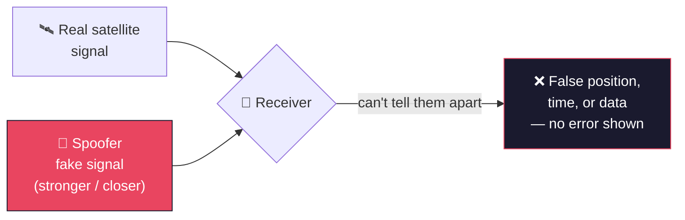

# Spoofing / Injection

**Goal:** impersonate a legitimate signal to inject false data or commands. This is the step up from [`jamming-dos.md`](jamming-dos.md): jamming just drowns a signal in noise, spoofing *replaces* it with something convincing — the receiver keeps working perfectly, it's just been fed a lie.

---

## How it actually works

A jammer wins by being louder. A spoofer wins by being *believable*: it transmits fake satellite-like signals, timed and structured to look exactly like the real thing, and the receiver computes a false result — wrong position, wrong time, wrong data — without ever knowing anything's wrong.

The core weakness that makes this possible: GPS (and most satellite broadcast systems generally) is **one-way**. The receiver never sends anything back to confirm what it received is authentic — it just trusts whatever signal arrives looking right. There's no built-in handshake to catch a convincing fake. As one researcher in this space put it plainly: a good enough lookalike signal can always fool a receiver.

## Real incidents — this is already a global-scale problem

Spoofing has gone from a rare anomaly to a documented pattern across multiple regions:

- **Black Sea (from 2017)** — one of the earliest documented spoofing regions, and it's grown more sophisticated since.
- **Middle East (2023)** — at least 20 civilian aircraft were misled by their own onboard GPS into flying near Iranian airspace without clearance — a situation that could easily have become a real diplomatic incident.
- **Eastern Mediterranean (ongoing)** — flights heading toward Turkey, Cyprus, or Israel are frequently spoofed, with receivers showing the aircraft at Beirut airport or in Cairo instead of its real position.
- **Delhi, India (Nov 2025)** — Indira Gandhi International Airport was hit by spoofing starting roughly 60 nautical miles out, causing the second-highest number of flight disruptions *worldwide* that day (per Flightradar24). About 7 flights were diverted to Jaipur, and a key GPS accuracy measure dropped to zero. It coincided with runway ILS upgrades that had made arriving aircraft more dependent on satellite navigation than usual — a reminder that reducing redundancy, even temporarily, raises how much damage spoofing can do.
- **India-Pakistan border** — roughly 465 GPS interference/spoofing incidents logged between Nov 2023 and Feb 2025, including Indian Air Force aircraft carrying earthquake relief to Myanmar in March 2025 having to fall back to backup navigation mid-mission.
- **The scale, globally**: IATA recorded **430,000 GPS jamming or spoofing incidents** over conflict zones in the past year alone — a 62% rise from 2023.

## Why defending against it is genuinely hard

Large commercial aircraft carry front and rear GPS antennas, and cross-checking the two could catch nearly all spoofing attempts — but Boeing has said the two need to operate *independently* for safety redundancy against ordinary equipment failure. That's the real tension: the hardware design that protects against accidental failure is the same design that leaves an opening for deliberate spoofing, and building something that solves both at once is a genuinely unsolved problem, not an oversight.

## Why this matters for the end-to-end chain

Spoofing is where "fooling a system" becomes more valuable than "breaking a system" — a target that's been successfully spoofed doesn't know anything is wrong, which is exactly what makes it the foundation for [`c2-hijacking.md`](c2-hijacking.md): once you can convincingly impersonate a signal, the next step is aiming that same impersonation specifically at a satellite's own command-and-control interface, not just a GPS receiver.

---

**Next:** [`c2-hijacking.md`](c2-hijacking.md) — spoofing aimed specifically at the satellite's command interface: the first real "takeover" milestone.
