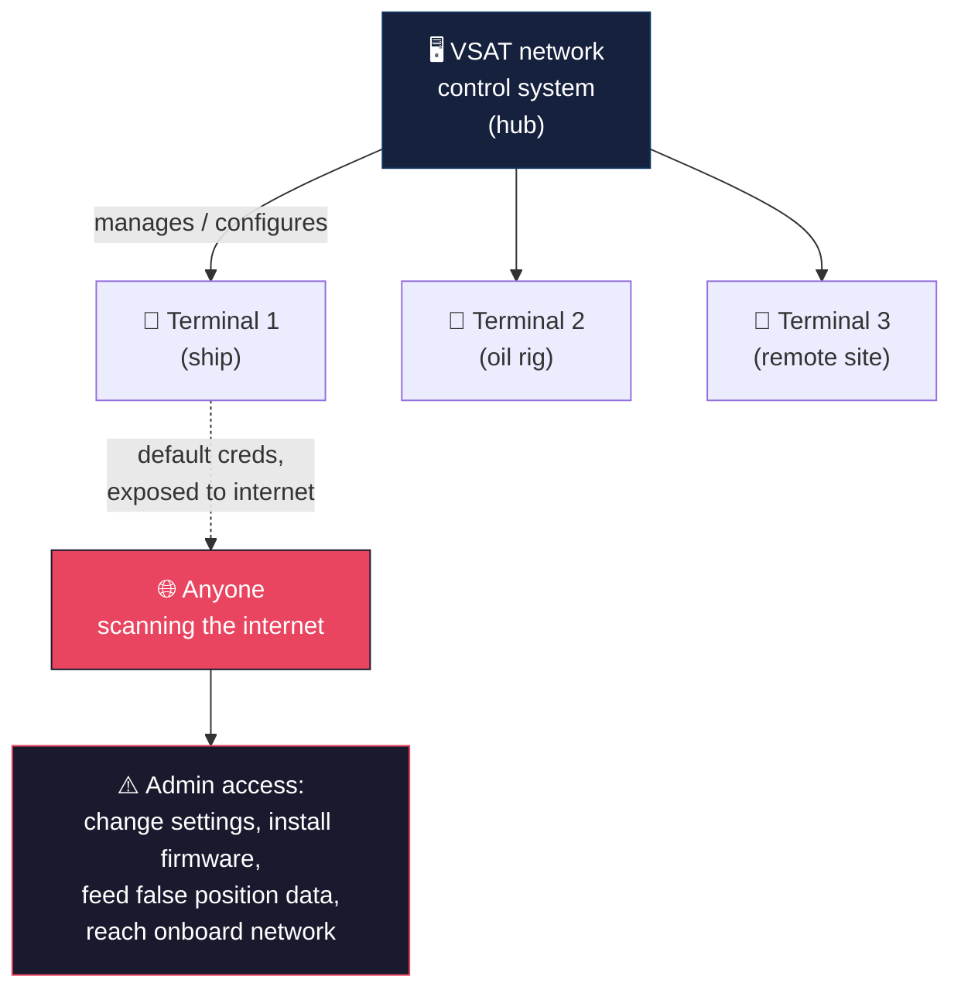

# VSAT Network Attacks

**Goal:** step back out from the spacecraft itself to the ground network that connects to this whole chain — the VSAT (Very Small Aperture Terminal) terminals and the command-and-control infrastructure behind them. [`attack-surface/user-segment.md`](../attack-surface/user-segment.md) already covered breaking into *one* VSAT modem; this file is about the bigger picture — the control network behind *all* of them, and how badly-managed terminals show up at scale, worldwide, in the real world.

---

## How it actually works

A VSAT terminal is never really alone — it's one endpoint in a hub-and-spoke network, managed by a network control system that configures, monitors, and updates every terminal on that network from one place. That management layer is where this file's real finding sits: research into how these control networks are actually built has found that the weaknesses aren't isolated bugs in one terminal model. They're **design-level problems in how the whole system is put together** — authentication, segmentation, and management practices that were never built with an adversarial network in mind.

That matters because of what rides on these networks: VSAT links carry critical infrastructure traffic — transportation, oil rigs, maritime, consumer internet in places terrestrial connections don't reach. A weakness at the control-network layer doesn't threaten one ship or one oil platform; it threatens everything that network touches.

## The research: design flaws, not just bugs

In 2024, researchers from CISPA, Oxford, and Ruhr-Universität Bochum (Willbold, Schloegel, Bisping, Strohmeier, Holz, Lenders) published **VSAsTer**, a systematic reverse-engineering study of the command-and-control networks behind VSAT systems from leading industry vendors — a part of the stack the researchers note has received comparatively little security scrutiny, even as attention on the terminals themselves has grown (this is the same gap [`attack-surface/user-segment.md`](../attack-surface/user-segment.md) and the DEF CON 32 VSAT modem work stepped into on the terminal side).

What they found: "a number of wide-reaching vulnerabilities," organized through a phase-based threat model built specifically to categorize them — and, more significantly, **several inherently insecure design practices** running through the whole ecosystem. The distinction matters: a single vulnerable function can be patched in an update. A design practice baked into how a whole class of systems manages trust and authentication is far harder to fix, because fixing it properly usually means redesigning the system, not issuing a hotfix.

The paper also makes a point of grounding this in reality rather than theory: state-sponsored groups are already exploiting space-based networks and causing real outages (the same category of event as the Viasat/AcidRain incident covered back in [`fundamentals/why-satellite-cybersecurity.md`](../fundamentals/why-satellite-cybersecurity.md)) — meaning the control-network layer isn't a hypothetical attack surface, it's one that's already being used.

## What this looks like at scale, in the real world

The design-level weaknesses above aren't abstract — they show up constantly in how individual terminals get managed. A long-running, recurring pattern (first surfaced publicly around 2017 by researcher @x0rz using a Shodan-based tracking service for ships with VSAT antennas, and repeatedly rediscovered since) keeps finding the same thing: VSAT terminals, mostly maritime Sailor systems, sitting **directly reachable from the public internet**, still running **factory-default admin credentials**, over web, Telnet, or SSH consoles that were genuinely never meant to face the internet at all — vendor documentation explicitly warns the equipment "is not designed to be connected directly to the Internet."

What that access actually gets an attacker:
- Full admin console access to the terminal's configuration
- The ability to change **azimuth calibration** — which can feed the vessel **false position data**
- Installing different firmware on the terminal
- Pulling stored data logs, including the vessel's travel history
- Potentially a path onward into the ship's onboard local network and whatever's connected to it

Separately, penetration testing of a specific vendor's VSAT modems (SatLink, tested by Trustwave SpiderLabs) found the same pattern baked into the hardware itself: a reflected cross-site-scripting flaw in the web management interface, and — more fundamentally — modems that supported **only HTTP and Telnet**, with no option for an encrypted management protocol at all on some models. Anyone positioned to intercept that traffic could capture credentials or hijack the management session outright.

## Why this matters for the end-to-end chain

This file is a reminder that the chain this folder builds doesn't only run *up* toward the spacecraft — it runs sideways, across the ground network that manages dozens or hundreds of terminals at once. A single exposed, default-credentialed terminal can be the quiet entry point into a much larger network, the same way a single compromised ground-station link was the entry point in [`attack-surface/ground-segment.md`](../attack-surface/ground-segment.md). And because these are design-level weaknesses, not one-off bugs, they tend to persist across firmware updates and across vendors — which is exactly why this surface keeps getting rediscovered, year after year, by different researchers.

---

**Next:** [`replay-telemetry-tampering.md`](replay-telemetry-tampering.md) — the last file in this folder: how an attacker, once inside, stays hidden by manipulating what the operators actually see.
